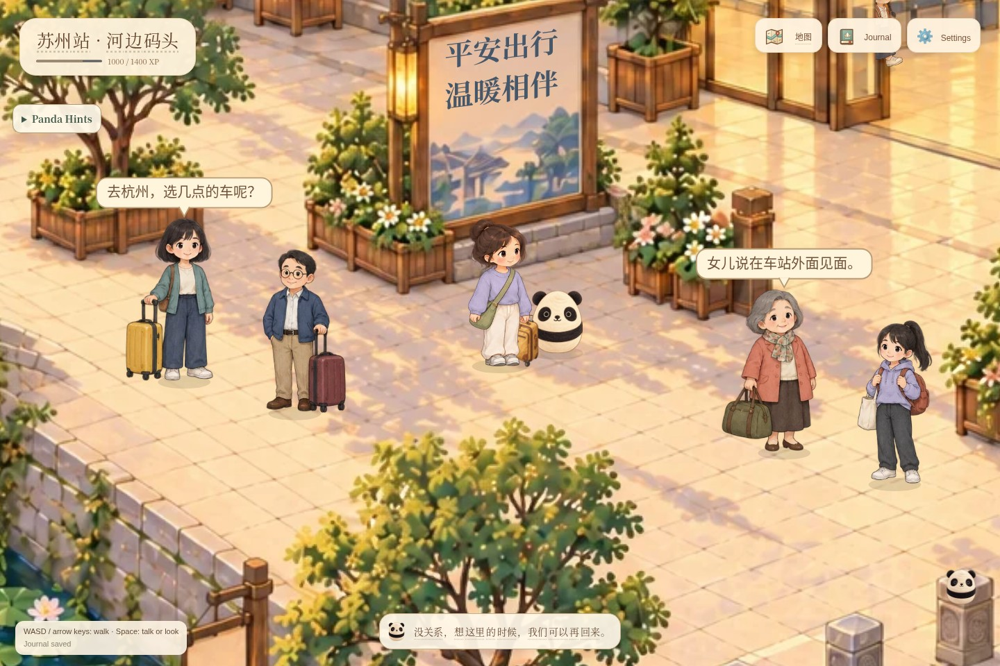
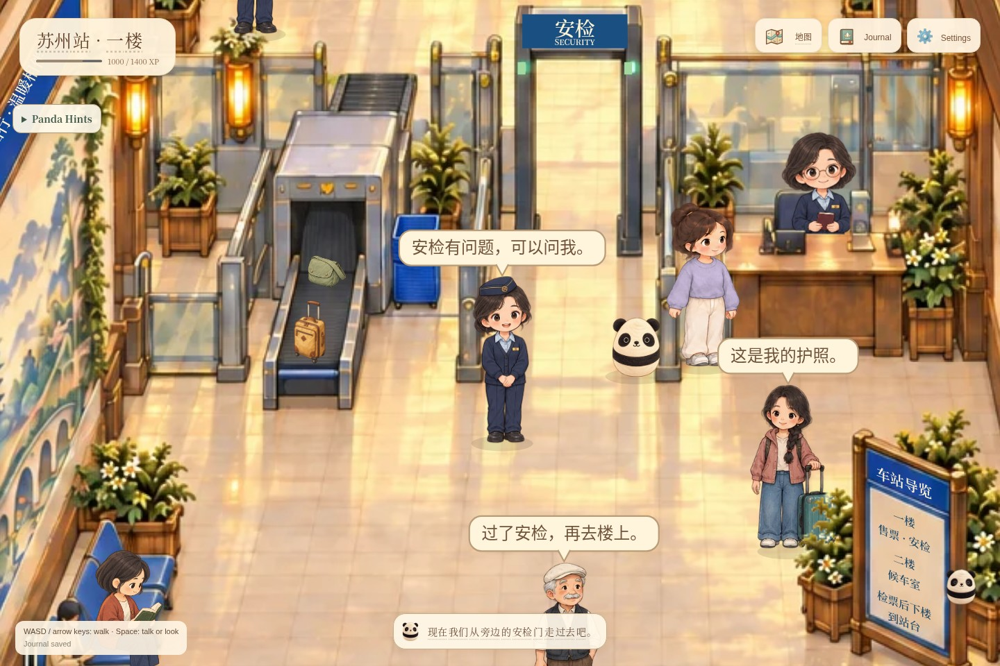

# Xiongmao World 熊猫世界

A self-hosted Chinese exploration game set in a painted, Suzhou-inspired canal town. Wander with Panda, meet neighbors, share meals, help travelers, and practice Chinese through everyday conversations and activities.

The playable world now includes the town and its interiors, the station forecourt, ticketing and security hall, upstairs waiting hall, and railway platform. Train arrival and a saved boarding confirmation are implemented; the train ride and Shanghai destination are still to come.


## A glimpse of the world

Screenshots from the game. Click an image to take a closer look.

[](docs/screenshots/station-forecourt-sign.jpg)

*Outside Suzhou Station: meet travelers and practice talking about journeys, departure times, and family.*

| Canal walks | Station security |
| --- | --- |
| [](docs/screenshots/canal-walk.jpg) | [](docs/screenshots/station-security-check.jpg) |
| Cross stone bridges and meet people along the water. | Show your passport, screen your luggage, and continue upstairs. |

| Suzhou Museum | Tea and conversation |
| --- | --- |
| [](docs/screenshots/museum.jpg) | [](docs/screenshots/tea-conversation.jpg) |
| Discover exhibits and listen to short Chinese descriptions. | Chat with neighbors, tap unfamiliar words, and ask Panda for help. |

| Hotpot together | Clothing shop |
| --- | --- |
| [](docs/screenshots/hotpot.jpg) | [](docs/screenshots/clothing-shop.jpg) |
| Order ingredients and add food to the pot. | Browse clothes and practice shopping with the seller. |

## What you can do

- **Explore Suzhou.** Visit market stalls, canals, gardens, a bamboo courtyard, the museum, shops, teahouse, restaurant, and homes. Moving neighbors, animals, boats, water, ambient sounds, and music bring the town to life. Panda follows your route and comments on places and discoveries.
- **Talk and learn.** Type or speak replies, ask questions, change topics, and replay dialogue at normal or slower speed. Tap Chinese words for contextual pinyin and definitions. Full pinyin and English translations are optional and off by default. Ask Panda for explanations, translations, or reply suggestions; conversation feedback offers corrections and examples. Authored Chinese and AI replies use a beginner vocabulary range based on the older HSK 1–3 lists, with familiar game terms allowed.
- **Help neighbors.** Find Lan’s flowers, give and follow directions, share tea with Qiao, take Lian to hotpot, find Momo’s toy, and explore with Panda. At hotpot, review your order, choose ingredients, cook, and eat; a shared meal with Lian leaves a keepsake at home.
- **Practice daily life.** Neighbor activities and mini-games cover listening, recipes, sentence building, object matching, shopping, gifts, animal clues, lantern riddles, and silk colors. The family home adds chores, a lost-book search, room descriptions, weather, seasons, clothes, and Spring Festival preparations. Activities support hints, retries, replay, and saved progress; practice purchases and prices are fictional.
- **Travel through the station.** Cross the quay bridge, help Xiaocheng find the entrance, book a Shanghai ticket, show your passport, put your bag and suitcase on the conveyor, pass the detector, and collect your belongings. Go upstairs by escalator or lift to explore shops, seating, hot water, toilets, and boarding gates. Help travelers with water, rest, directions, security instructions, and platform trash. After the upstairs boarding check, descend to the platform and talk with fellow passengers while the train arrives.
- **Keep your progress.** Journal records activities, words, memories, and conversations. XP and completed rewards persist across reloads. Settings includes appearance, movement pace, language help, text size, reduced motion, voice, music, and environment sound controls, plus save export and device pairing.

Progression uses participation XP, not a proficiency score. XP is not spent when traveling.

| Milestone | Requirement |
| --- | --- |
| Boat from town to the station | 750 total XP |
| Upstairs boarding check and platform access | 1,400 total XP, a booked ticket, and completed security |
| Train arrival and boarding confirmation | Arrival follows 100 XP from platform conversations; boarding also requires 1,500 total XP |

The train waits without a deadline. Boarding saves completion but does not yet enter a carriage or start a journey. Further cities and automatic proficiency assessment remain planned. Suzhou’s layout and travel schedules are fictional interpretations, not a real street map or live railway information.

## Playing

On a computer, use **WASD/arrows** or click the ground to walk. Click a person or building to approach and interact, or press **Space/E** nearby. On a phone, tap destinations or hold and drag to steer. **Map** helps you find places; **Panda Hints** and **Journal → What to do** explain available activities.

Dialogue can use authored story replies, local Ollama, or Gemini. AI failures fall back to labeled story replies. Speech generation and microphone transcription run locally when their optional tools and models are installed. Panda has a separate Kokoro voice; voice configuration is documented in [Panda voice](handoff/references/panda-voice.md) and [voice casting](handoff/references/voice-casting.md).

## Run locally

Requires **Node 26.8.2–26.x**. SQLite is provided by Node; no separate database service is needed.

```sh
npm ci
cp .env.example .env
npm start
```

Open [http://127.0.0.1:3210](http://127.0.0.1:3210). The default `PROVIDER=story` works without an AI account. For local AI, set `PROVIDER=ollama` and run the configured Ollama model. For Gemini, set `PROVIDER=gemini`, `GEMINI_API_KEY`, and `GEMINI_MODEL` in `.env`; those dialogue and coaching requests go to Google, while the key stays on the server. See [.env.example](.env.example) for configuration. Speech models and downloaded tools are not included in a source checkout.

On the configured development PC, the user services can be managed with:

```sh
systemctl --user status panda-world.service panda-local-ai.service
systemctl --user restart panda-world.service
```

Stop `panda-world.service` before running a terminal server on the same port. If the project or Node path changes, use `node scripts/install-services.js --install` to regenerate the service files.

## Saves, offline play, and phones

SQLite saves live in `data/`; browser storage retains offline progress. **Settings → Save and devices** offers export, pairing with a short-lived single-use code, and explicit conflict resolution between devices. Run `npm run backup` for a consistent SQLite backup in `data/backups/`. Preserve `.env`, `data/`, and installed `tools/` separately; Git excludes these files.

The installable web app caches exploration code and artwork. Offline play uses the device’s last save and authored content; server AI, generated speech, microphone transcription, pairing, and synchronization require connectivity. Close all game tabs and reopen to activate a downloaded update. Phone access needs a reachable server, and microphone/PWA features need a secure origin such as private HTTPS. Physical-phone installation and performance remain unverified; browser checks include emulated touch screens.

## Development and credits

The code separates world scenes, characters and artwork from shared movement, rendering, interactions, and saved state. See [Adding a world](docs/ADDING_WORLDS.md) for extension points and [the refactor record](docs/refactor/EXECUTION.md) for migration and verification details.

```sh
npm run check
npm run check:worlds
npm test
npm run test:browser
```

Unit/API checks cover navigation, saves, activities, dialogue, and rewards. Browser scripts use disposable in-memory servers and isolated Chromium profiles, keeping the live save untouched; speech and microphone checks need the local speech tools. Focused station and activity checks, including recorded test limitations, are described in [station and activity implementation notes](docs/REMAINING_ACTIVITIES_HANDOFF.md). Generated test screenshots are kept in ignored `test-results/`.

[Artwork records](art/ASSETS.md), [Suzhou research](SUZHOU_RESEARCH.md), and [third-party credits](THIRD_PARTY.md) document art provenance, cultural references, and dependencies. Music credits and the locally supplied home recording’s redistribution status are in [audio attribution](public/assets/audio/ATTRIBUTION.md). [PLAN.md](PLAN.md) and [PROGRESS.md](PROGRESS.md) retain the broader roadmap and development history.
