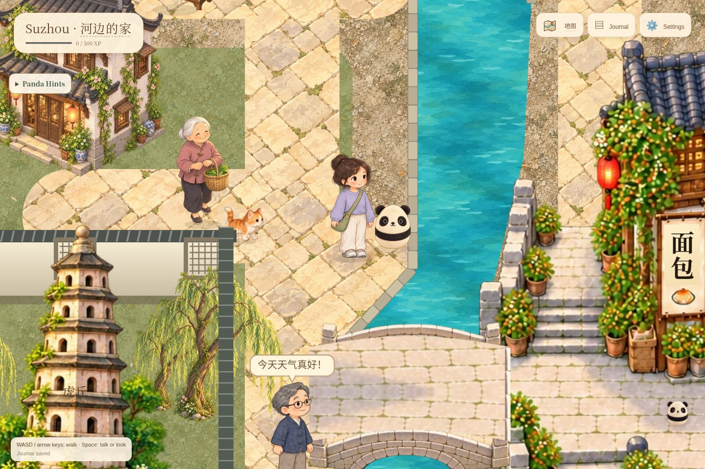
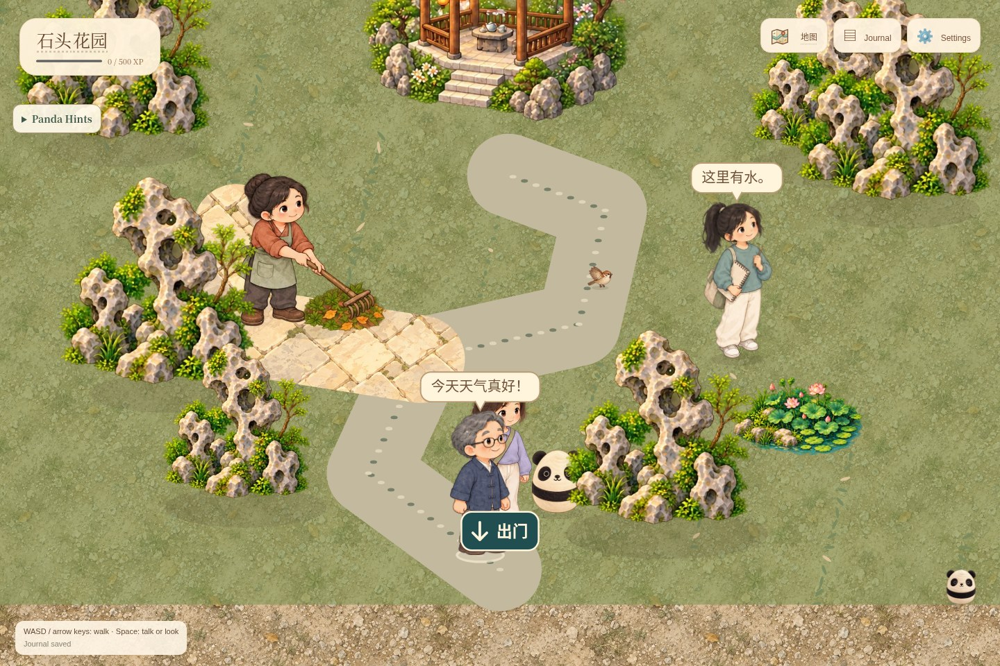
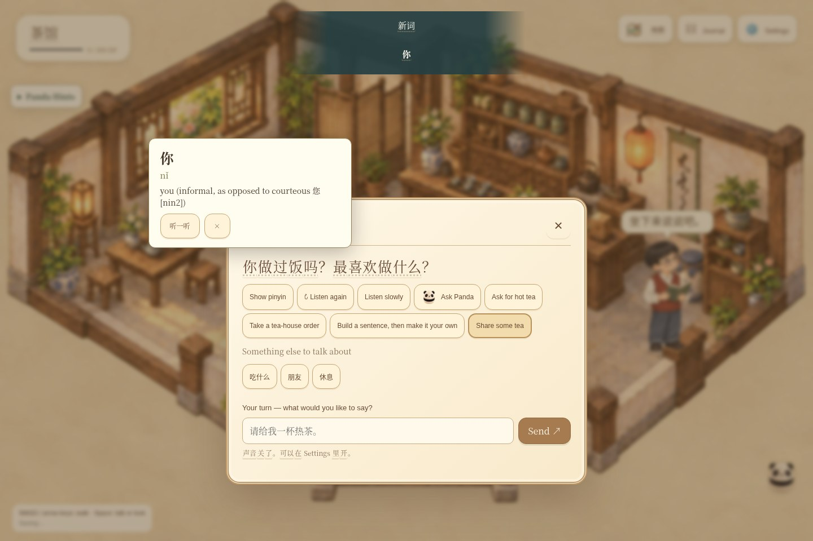
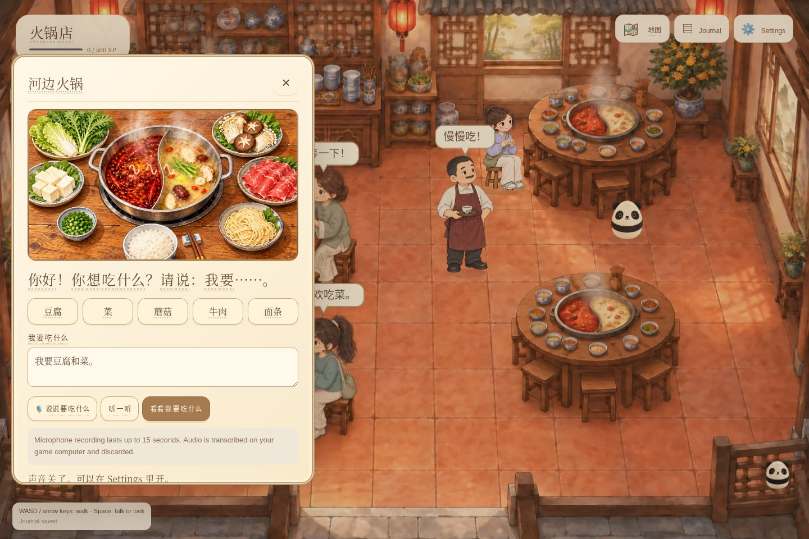

# Xiongmao World 熊猫世界

Wander a painted Suzhou-inspired canal town with Panda, meet the neighbors, and practice Chinese through conversations, quests, and everyday activities.


## A glimpse of the world

These screenshots show the current game. Click an image to take a closer look.

[](docs/screenshots/market-center.jpg)

*In the heart of the market: browse the stalls and practice everyday Chinese with the sellers.*

| Canal walks | Classical gardens |
| --- | --- |
| [](docs/screenshots/canal-walk.jpg) | [](docs/screenshots/classical-garden.jpg) |
| Follow the water, cross stone bridges, and meet people along the way. | Explore garden paths, rockeries, and quiet places to sit. |

| Suzhou Museum | Tea and conversation |
| --- | --- |
| [](docs/screenshots/museum.jpg) | [](docs/screenshots/tea-conversation.jpg) |
| Discover exhibits and listen to short Chinese descriptions. | Chat with neighbors, tap unfamiliar words, and ask Panda for help. |

| Hotpot together | Clothing shop |
| --- | --- |
| [](docs/screenshots/hotpot.jpg) | [](docs/screenshots/clothing-shop.jpg) |
| Order ingredients, review your meal, and add food to the pot. | Browse clothes and practice shopping with the seller. |

## About the game

Panda offers brief language tips inside conversations: a correction, a natural phrasing suggestion, or a useful grammar point, with an example to listen to or put into the reply box. AI dialogue returns optional coaching in the same request; clear clock-minute errors also have authored coaching in story mode and during provider failures. Tips can be dismissed and never interrupt the NPC’s voice. Check this flow with `node scripts/browser-conversation-feedback.js`.

Journal opens to **What to do**, with a recommended or resumable activity, plain-English instructions and a clear completion condition. **My words** offers tappable pronunciation and definitions; **Memories** records adventures and keeps original older entries accessible. Activity guidance stays visible in town, and exploration activities offer a route to the next stop. Exercises are labeled as practice, separate from real purchases. Save export, conflict resolution and device pairing are under **Settings → Save and devices**. Check desktop and mobile flows with `node scripts/browser-journal.js`.

The responsive welcome screen introduces the world with illustrated town and conversation windows, a tappable vocabulary preview, keyboard/phone instructions, and Jacob Lee’s 2026 credit. The starting scene loads before offline installation begins; indoor backgrounds load on entry, with progress and retry controls. Browser WebP copies preserve atlas dimensions and transparency while keeping the original artwork. Rebuild them with `npm run art:optimize` (requires ImageMagick); check desktop/mobile entry, indoor saves and offline play with `node scripts/browser-welcome.js`.


A self-hosted Chinese exploration game in a painted Suzhou-inspired canal town. The market uses connected L-shaped shophouses, Chinese shop signs, a bending central lane, cross alleys and a waterfront loop. Its complete transparent perimeter meets the town's shared water and paving. The town is approximately **3775 × 3341**, with a wider western canal path and mixed fruit orchard in the southwest; the market keeps a compact, undistorted 3:2 footprint with clear shop approaches and a parallel-edged southern promenade.

The gardens, courtyards and northwest bamboo grove have visible walled grounds, roughly 2–3% of the town each, with clear gate approaches. **竹林小院** is a dense bamboo courtyard entered only through its door interaction. Its smaller scene has matching enclosing walls and a centered moon gate, with bamboo entirely inside the boundary. The duck pond and courtyard pond have mossy limestone, bank planting and small waterfalls; motion settings also control their ripples. Ground-click destinations use cream rings; interactive destinations retain blue rings.

Help **Xiaoyu** on the north lane find the flower shop with a two-step directions quest (+40 XP), including hints, retries and saved partial progress. **Uncle Zhou** on the southern canal walk reminds visitors to walk carefully using short beginner sentences. All five market stalls retain their first-person seller views, fixed prices and purchases.

The southeastern **河畔广场**, west of the silk workshop, is an open paved square connected to the canal promenade. It replaces the former storytelling courtyard; saves from that room return safely to the square.

Ask Lin how to find the hotpot restaurant, then enter it; help Hao find the bookshop by giving directions. Both quests appear in Panda’s goals. NPCs and Panda use the [in-game location directory](handoff/references/game-directions.md) and shared map facts.

A lantern-lit Suzhou passenger boat waits in the bottom-right canal, beside the silk workshop. Click the boat to walk to its boarding dock, or press Space nearby. Departures unlock at **500 XP**; below that, the captain shows how much remains. At full XP, Panda adds a boarding goal. The boat currently connects to the existing Shantang next area, with a return trip to this dock.

Sit with Lian for hotpot and receive a sheep keepsake that appears at home with its story. Sit with Qiao at the larger tea table. An Ask Panda button beside the English dialogue controls opens contextual quick questions and a text box for grammar or translation help. Local AI answers open questions when available; authored help remains available offline.

Click a person or building to walk over and interact automatically. Walk with WASD/arrows and press **Space** (or E) nearby. The goal cards at the upper left show the next action and can guide you there. Meet five people, help Lan find her flowers, share tea with Qiao, treat Lian to hotpot, and take Panda’s nature walk. Shops sell osmanthus cake, tangerines and an embroidered round fan with fictional in-game coins. Journal keeps words, purchases and quest progress.

Quiet procedural water, duck and bird sounds follow nearby nature, with a separate **Nature sounds** volume in Settings. They fade indoors, while speaking and when the tab is hidden. Museum, garden and home narration uses short beginner-friendly sentences.

Gated grounds with a separate interior are entered only by interacting with their moon gate; their town-view footprints are solid and entrance trees are cleared. Two homes sit at the far south center. The open southern square has a small limestone fountain with flowing water and four circling birds; reduced motion freezes its animation.

Music begins after the saved scene is ready and reuses one player when changing rooms. Reinitializing the game releases the prior audio graph. Online local previews share soundtrack ownership across separate browser contexts and preview ports; a handoff waits for the prior player to stop, and Music Off also silences another active preview. Saved mute, speech ducking and offline playback remain supported. Browser regressions mute hardware output while still testing the audio graph.

Chinese dialogue plays automatically. Full English and pinyin are hidden by default; click a dialogue word (or focus it and press Enter) to see pinyin and its definition above the panel. Only the first explicit click on a word triggers its foreground discovery banner and chime. Settings can reveal full translations or pinyin. The 0.7 map migration resets these two defaults once; later choices persist. Dictionary lookup requires the local server; offline play retains a small authored vocabulary fallback.

[PLAN.md](PLAN.md) and [PROGRESS.md](PROGRESS.md) record prior development; [SUZHOU_RESEARCH.md](SUZHOU_RESEARCH.md) contains the current research and design sources.

## Play on this PC

Open **http://127.0.0.1:3210**. Game and private local AI run as enabled user services. On a phone, hold the screen to keep walking in that direction, drag to steer, and release to stop. Tap the ground to walk there, or tap a person or building to walk over and interact or enter. On a computer, walk with WASD/arrows or click clear ground; routes avoid buildings and canal edges. Panda follows half a second behind, interpolating the player’s trail through uneven frame timing; his grounded hop poses advance with his own traveled distance. `node scripts/browser-panda-walk.js` checks movement, pose alignment, pause, scene changes and reduced motion on desktop/mobile sizes. Open Map and select a destination to walk there. Press Space/E or use the interaction button near a person/object. Tap Panda's face to expand his help panel.

Meet Mei at the noodle shop. Type a short Chinese or English reply, ask questions, change topics, request help or leave. Dialogue speaks on opening and after replies; Replay/slow replay remains available. Speech uses the displayed line immediately without waiting for optional AI wording changes. Late rewrites are kept for later visits rather than replacing a line already being spoken. `node scripts/browser-speech-latency.js` checks speech startup with a blocked rewrite, playback, and both replay speeds. Every dialogue word supports dictionary lookup. Optional pinyin sits above each Hanzi word and wraps with it. Character activity buttons launch only that character’s named games; characters with no related game or quest have no activity button. Ask Panda offers “How can I respond to this?” and two quick questions built from the current dialogue, plus a text box for your own questions. Explanations in this popup are in English; Chinese examples can be copied into your reply. Check desktop/mobile controls, contextual questions, and reply insertion with `node scripts/browser-dialogue-help.js`. No expected answer is required.

Find Momo near a canal bridge and bring the toy home. Meet the original neighbors, two additional market vendors and six strolling passersby. Explore the lotus lake, gardens, bakery, teahouse, bookshop and market stalls, then enter the museum, restaurant or your own home. Use E or the interaction button at objects and doors. Journal retains discoveries and explicitly shared preferences. Settings supports outfit colors, hair, pace, help, challenge, pinyin/meaning, text size, motion, voice and music volume. Changes can be undone; unsupported development feedback is visibly pending.

Choose **练习中文** beside Panda or **中文练习** in a conversation. The nine neighbor activities cover ordering, quantities, gifts, listening, open expression and visits. Eight mini-games add recipes, listening orders, Chinese/object matching, sentence building, animal clue walks, lantern riddles, silk colors and budget shopping. New games vary their rounds on replay and preserve partial progress across reloads. They offer replay, slower speech, optional transcripts and hints. Retries have no penalty; completing an activity does not claim language mastery. Open expression is saved in the neighbor's conversation history, where local AI can continue the conversation.

Visit Tiger Hill Pagoda, a classical garden, Suzhou Museum and Pingjiang canal lanes for short Chinese descriptions with Mandarin replay and optional meaning. The bakery introduces osmanthus sweets, while lantern riddles and the silk workshop introduce Lantern Festival customs and Suzhou embroidery. Each cultural entry links its primary source. The district condenses these places into an illustrated game interpretation; it is not a geographically accurate street map.

From **Map**, choose **Lantern riddles**, **Silk workshop** or **Market shopping**, walk there and press E. Riddles practice descriptions; the 3 × 3 cloth practices colors and positions with undo and an eraser; shopping practices quantities, measure words, yuan and change. Each game has different replay rounds. The cloth is a simplified language activity, and market prices are fictional practice prices.

Moving neighbors, including Lin and the two children, use four painted walking poses each. The children have dedicated sprites. Player idle and seated poses preserve outfit colors, and facing persists when stopping. The rabbit hops between rests. A newly painted, smaller Panda hops faster and follows the player’s route. Six strolling visitors have their own Chinese speech bubbles and conversations. Seven roaming animals and sparrows, falling leaves, moving boats and water add life. White hover outlines identify people; blue dots and outlines identify building interactions. Reduced motion freezes scenery and animated poses.

The central painted canals and outer waterways have clearly connected bridge crossings; shared geometry defines the visible water and blocked floor. Opaque earth, stone lanes and garden beds replace translucent terrain seams. Buildings block their visible footprint. New and migrated saves move to safe ground when necessary, preserving preferences and learning history. Each room exit returns to its real exterior door, including the single home in the northwest.

New things to try:

- Talk to **Lan** outside the flower shop, accept her lost-flower quest, cross the canal to the rockery, then return the bouquet: **60 XP**.
- Inspect the courtyard tea set, invite **Qiao**, watch her walk over and sit, then share a Chinese response: **60 XP**.
- Enter the **museum** and inspect the lotus bowl, Pearl Pillar and canal-layout display: **15 XP** per first discovery. These are sourced historical subjects with illustrative art, not exact collection reproductions.
- Enter the **restaurant**, approach the hot-pot table, and speak or type an order. Review/correct the transcript, confirm the ingredients, add the served food to the pot and eat: **25 XP** per completed meal. Closing the panel discards an unfinished meal; completed XP is saved.
- Inspect five objects at home for short personal stories. Talk to every neighbor or passerby: each completed conversation turn earns **10 XP**. Completed practice rounds earn **20 XP**.
- At **500 XP**, the southeast gate opens a playable Shantang quay with another host, canal and lantern activity. XP measures participation, not Chinese proficiency.

NPC speech uses a fixed cast matched to age and gender. The approved Kokoro voices zf_001 and zf_026 serve adult women; zm_009, zm_014, zm_020, zm_055 and zm_068 serve adult men. Children retain their existing younger voices, and older women retain AISHELL3 where assigned. Four older male identities retain WNJ (Bo, waiter, visitors 0 and 4); four use Kokoro zm_015 (Wei, gardener, visitor 2 and the courtyard caretaker). Conversations and replay preserve each NPC's identity, including the reader's older portrait in two rooms; practice uses its host's profile. See [voice assignments and rollback](handoff/references/voice-casting.md). Hot-pot recognition uses local faster-whisper/base on this PC. Recordings are bounded to 15 seconds, passed through memory and never saved by the game; recognition needs connectivity to this server. A microphone requires localhost or HTTPS. The transcript is always editable and must be reviewed before ordering. Synthetic-speech checks recognize ingredient names but also make errors; natural learner speech remains untested.

Panda's hint speaker button and Ask Panda examples use audition A: a light, nasal, playful Kokoro zm_009 voice with pitch and EQ effects. New lines are generated locally using the same installed Kokoro model as the NPCs. Replays use a pronunciation-aware disk cache, and slow speech changes tempo without changing Panda's pitch. The former Qwen TTS models and environment have been removed. See [Panda voice setup](handoff/references/panda-voice.md). `/api/health` reports `pandaVoice` separately from the NPC speech engine.

Background music is **“Asia” by FSM Team**, a relaxing Asian-inspired lo-fi/chill-hop instrumental bundled locally under [CC BY 4.0](https://creativecommons.org/licenses/by/4.0/). [The artist's track page](https://www.free-stock-music.com/fsm-team-asia.html) permits use in games with credit; the credit appears in Settings and [the bundled attribution](public/assets/audio/ATTRIBUTION.md). It starts after pressing Wander, quiets during Mandarin speech and pauses when the page is hidden. Use **Settings → Music** to switch it on/off or change the volume. An original procedural score remains the fallback if the recording cannot load. No remote music request occurs during play.

Home plays **“花 / Hana (Flower)” by Masaaki Kishibe, performed on guitar by Daria Semikina**, the user-selected [performance](https://www.youtube.com/watch?v=-KrlR5UM6dI). This personal recording is stored locally as `public/assets/audio/hana-daria-semikina.mp3`, excluded from source control, and cached offline when present. Its redistribution permission has not been verified; see [the attribution record](public/assets/audio/ATTRIBUTION.md). Other indoor rooms keep “Asian Music – Magical Dream” by Sonican. Hana is prepared after the Wander tap and its decoded buffer is retained across room visits, so entering Home starts without another download or decode. Playback uses a very short startup fade; normal volume changes and speech recovery keep their gentle fade. Entering and leaving Home switches the existing player; looping, volume, speech ducking and hidden-page pause apply to all tracks.

Pinyin and full English are **off by default**. Version 0.7 migrates these defaults once; later saved preferences stay unchanged. Use **Hide pinyin / Show pinyin** inside any conversation to change pronunciation support immediately. This also applies to phrase explanations and activities, shares the Settings preference, persists after reload, and can be reversed with **Settings → Undo last change**.

The town reuses painted cutouts with new Panda, walking-neighbor, seated-Qiao, earth, museum and restaurant assets. [art/ASSETS.md](art/ASSETS.md) records saved files, exact built-in generation prompts and provenance. [SUZHOU_RESEARCH.md](SUZHOU_RESEARCH.md) records the primary sources and real photographs used for landscape decisions. Settings are entirely in English. Gameplay uses short Chinese within the old six-level HSK 1–3 vocabulary, with HSK 2–3 as the normal practice range. The list is a difficulty guide, with an explicit set of familiar game words such as 书店, 花店, 茶馆, 河, 湖, and 桥 kept in Chinese. Names, specialist foods, cultural labels, and technical instructions use English when they need harder words. The shared vocabulary check uses the official 2015 list, checks authored content in tests, and allows those everyday game words while rejecting harder AI dialogue or coaching in favor of beginner story replies. Familiar grammatical forms and measure-word abbreviations are listed explicitly. Translation and pinyin remain opt-in. Painted market signs receive beginner labels at render time. Panels use cream paper, a double frame, brown text and reduced-motion-aware transitions.

Five cities, full directional animation, richer daily routines, environmental audio, verified automatic ability assessment and a source-editing agent remain future work. The map condenses real Suzhou features into a fictional arrangement.

## Run, stop and restart

Installed: Node 26.8.2, built-in SQLite, one production dependency (`pinyin-pro`). Playwright and Prettier are pinned development dependencies. Node SQLite is currently a release candidate. See [THIRD_PARTY.md](THIRD_PARTY.md) for runtime sources/licenses.

```sh
cd /home/jlrj/Documents/lotus
systemctl --user status panda-world.service panda-local-ai.service
systemctl --user restart panda-world.service
```

Services start when this user logs in. Actual reboot/login has not been tested. They do not keep the PC awake; phone live features require the PC awake and reachable. No system-wide packages, router rules or firewall changes were installed.

To run in a terminal:

```sh
systemctl --user stop panda-world.service
npm start
# Ctrl+C stops the terminal server.
systemctl --user start panda-world.service
```

To stop or disable startup:

```sh
systemctl --user stop panda-world.service panda-local-ai.service
systemctl --user disable panda-world.service panda-local-ai.service
```

On a fresh source checkout, `npm ci` installs npm dependencies; copy `.env.example` to `.env`. Set `PROVIDER=gemini`, `GEMINI_MODEL=gemini-3.5-flash-lite`, and `GEMINI_API_KEY` for Gemini dialogue and Panda coaching. The key stays on the server; dialogue and coaching requests are sent to Google's Gemini API. Use `PROVIDER=ollama` for local Qwen3 4B or `PROVIDER=story` for authored replies. API failures use explicitly labeled limited story replies. Speech and SQLite saves remain local.

Service files use absolute project/Node paths. If those move, run `node scripts/install-services.js --install`, then `systemctl --user daemon-reload` and restart. The installer refuses to replace unrelated service files.

## Saves and backup

SQLite stores each world on the PC. Identity uses an HttpOnly cookie; pairing shares a world through a single-use code lasting five minutes. Browser storage preserves offline changes. Save revisions prevent silent overwrites between devices. Settings → Save and devices offers export and an explicit conflict choice. Keeping this device also preserves server discoveries; using server progress replaces the local copy, so export first if you want both.

```sh
npm run backup
```

A consistent live SQLite backup goes under `data/backups/`; this was actually tested. To restore: stop the game service, keep copies of current `world.sqlite` and its WAL/SHM files together if present, replace the database with the backup, and move the old WAL/SHM files out of the way before restarting. Clients with unsynced progress will need the journal conflict choice after a rollback. Restoration on an actual learner save is untested.

For machine backup, preserve the whole project including ignored `data/`, `.env`, and `tools/`, plus Ollama’s normal `~/.ollama/` identity. Git excludes saves, models, config, downloaded runtimes and test output. Source alone does not include downloaded Ollama/eSpeak binaries or model weights.

## Phone/PWA — Tailscale activation pending

Prepared origin: **https://omarchy.tail18f12c.ts.net**. The user explicitly approved persistent private HTTPS for the existing Tailscale network. The retry was accepted, but Tailscale reports that Serve is disabled for this network and requires its account activation page. **The HTTPS route is not yet enabled or verified.** Localhost works.

The approved route uses Tailscale Serve for devices permitted by existing tailnet policy. Those devices can open the game and create a world; accessing an existing world requires its session or pairing code. It does not use public Funnel hosting. After enabling Serve in the Tailscale account, run `tailscale serve --bg --https=443 http://127.0.0.1:3210` and verify `tailscale serve status`.

After activation: use the same HTTPS URL on PC and phone, with the phone connected to the same Tailscale network. Create a pairing code in Settings → Save and devices on the device whose progress you want and enter it on the other. Install using the browser menu on Android/desktop or Safari Share → Add to Home Screen on iPhone. These actual-device steps are unverified.

The offline cache contains the exploration shell, art and licensed background recording, never API identities, saves, dialogue responses or generated Mandarin audio. Offline exploration/settings use the last device copy. Server AI, speech, pairing and sync need connectivity. Updates wait for the Update button and require synced progress. Bump the cache version in `public/sw.js` for new releases, keeping old/new caches separate until activation.

## Validation

The maintained browser checks start disposable in-memory servers and isolated Chromium profiles. They never seed the live game database. The actual microphone check requires the installed local speech tools, Whisper model and system `ffmpeg`:

```sh
npm test
npm run check
npm run test:browser
npm run format
```

Unit/API checks cover collision, reachable destinations at normal/low frame rates, old-save migration, revisions, pairing, quest/XP validation, order parsing, settings, learning evidence and provider failures. The maintained browser suite covers the social quests, exact room returns, museum exhibits, first-person hot pot, actual MediaRecorder → local Whisper, hover hit targets, the 500 XP gate, all seventeen activities, pinyin, music and offline/reconnect/conflict recovery. Dialogue in these regression flows is mocked; microphone recognition and music playback are real. Phone-sized Chromium is tested; physical phone installation, performance and microphone behavior remain unverified. Older v0.2–v0.5 art/slice scripts retain historical geometry and are not part of the maintained suite. Screenshots/evidence live in ignored `test-results/`.

To reproduce local recognition on another PC, create `tools/asr-venv`, install `scripts/requirements-speech.txt`, then use Hugging Face `snapshot_download` for `Systran/faster-whisper-base` at revision `ebe41f70d5b6dfa9166e2c581c45c9c0cfc57b66` into `tools/whisper-base` (config.json, model.bin, tokenizer.json, vocabulary.txt). Only installation needs network access; runtime forces local files/offline mode. Model files and the virtual environment are ignored by Git.

Earlier Qwen3 4B checks returned food/hobby/homework replies in 7.1–13.9 seconds. The shorter beginner prompt returned a real Lian reply in **26.8 seconds** during this pass; latency varies with local load. The smaller model was rejected for echoing input and wrong pinyin; dictionary pinyin now replaces model spelling. Chromium decoded and started generated Mandarin. The selected WNJ male neural voice is checked with local ASR; subjective voice quality still benefits from learner feedback. No prerecorded dialogue or remote inference API is used.

## Reproducing the male neural voice

Install `scripts/requirements-speech.txt` in the existing project speech virtual environment. Download and extract [the documented WNJ model](https://github.com/k2-fsa/sherpa-onnx/releases/download/tts-models/vits-zh-hf-fanchen-wnj.tar.bz2) under `tools/vits-zh-hf-fanchen-wnj`. Runtime makes no remote speech requests. `scripts/synthesize-neural.py` generates bounded WAV audio on CPU; repeated question/exclamation marks are normalized before synthesis and trailing silence is trimmed. The young-female profile prefers a recognized local device voice, with AISHELL3 neural speech as the server fallback. The new young-male and older-female profiles use AISHELL3 directly on both desktop and phone. Install the [AISHELL3 model](https://k2-fsa.github.io/sherpa/onnx/tts/pretrained_models/vits.html#aishell3-chinese-multi-speaker-174-speakers) under `tools/vits-icefall-zh-aishell3` for that fallback. If the male model is absent, the basic male speech engine remains available and is labeled without claiming neural output.

Additional validation: `node scripts/browser-environment.js` measures ambient output/muting and checks that decorative scenery receives no blue hover shadow. `node scripts/browser-xiongmao.js` checks click-to-talk, both retained facing directions, on-demand definitions, Lian’s full meal quest and all new venues in isolated worlds.

`node scripts/browser-refinements.js` checks compact Panda portraits, click-only definitions and first-discovery banners, coaching questions, seated tea/hotpot, the sheep reward and its persistent home display. `node scripts/browser-market-review.js` captures the market boundaries, southwest tangerines and northeast bamboo for visual review.

Character-voice verification: `node scripts/browser-voices.js` synthesizes all twelve NPC profiles at both speeds, decodes their WAVs in a phone-sized Chromium context, and checks real NPC conversation/replay selection. Samples are saved under `test-results/voices/`.

Scripted dialogue chooses a preset half the time and requests a fresh, similar line from the configured LLM the other half. Provider failures and offline play keep a preset. NPC openings draw from four character-appropriate discussion subjects; the 16 subject pools cover routines, weather, family, friends, exercise, transport, study, work, shopping, cooking, rest, feelings, reading, music, gardens, and plans. Topic buttons start those conversations directly. Each open conversation sends only its current session turns, with the displayed NPC line immediately before the latest learner message. Saved conversation history and explicit preferences remain in the journal. Providers prioritize the latest input and get one repair attempt for repeated dialogue, malformed answers, or vocabulary rejections. If AI still fails, the UI shows a limited-story notice and a bounded failure category. Scripted fallbacks handle common invitations, tiredness questions and contextual tea choices; unsupported direct questions ask for clarification. Conversational fallbacks are not passed through the static-line variation generator. The vocabulary check supports productive short forms such as 学、睡、晚 and 火车, while retaining the old HSK 1–3 limit. Run `node scripts/browser-dialogue-variety.js` and `node scripts/browser-dialogue-relevance.js` for isolated desktop/mobile checks; the latter uses mocked Gemini replies and never calls an external provider.

Family conversations are anchored to the older artwork: Yun is 72, her husband is 74, and their adult daughter is 46; Zhou is 68, his wife is 67, and their adult son is 39. Their family buttons and opening pools use personal stories about breakfast, newspapers, company work, evening calls, weekend visits, cooking, and music. The LLM receives these fixed family facts; contradictory personal ages or child roles trigger repair or an authored fallback. The younger/student/child cast receives no invented spouse or children. `node scripts/browser-family-dialogue.js` checks both family buttons and age answers in an isolated mobile browser.

Dialogue editing references the old six-level [HSK 2 syllabus and sample paper](https://www.chinesetest.cn/userfiles/file/dagang/HSK2.pdf) (300 words) and [HSK 3 syllabus and sample paper](https://www.chinesetest.cn/userfiles/file/dagang/HSK3.pdf) (600 words), alongside the bundled 2015 vocabulary list. Scenes practice comparisons, choices, quantities, plans, experience with 过, ongoing actions with 正在/着, result complements, 把, 先…再…, 又…又…, 一边…一边…, 除了…还…, and 虽然…但是…. Clothing comparisons use the actual catalog prices; reading, food, and garden examples stay tied to their environments. A few ordinary scene words and grammatical forms remain explicit exceptions so the vocabulary filter does not force unnatural Chinese. English `meaning` fields translate the Chinese itself; cultural context belongs in a separate `note`. When editing a line, update its Chinese, pinyin, and translation together.

Language verification: `node scripts/browser-language.js` checks English settings, customization, undo, legacy vocabulary display, and every activity panel on desktop and mobile. `test/language.test.js` audits authored strings and confirms that both dialogue providers and Panda keep everyday game words in Chinese and reject harder Chinese.
